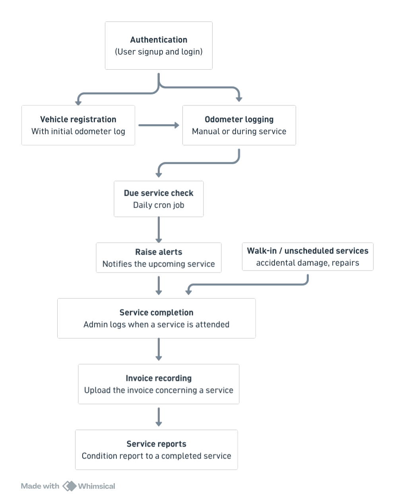

# Architecture


## Purpose

This document describes how the individual service objects fit together as a system, and the conventions applied consistently across all of them. Each workflow is documented separately under ```docs/services/```; this page is the map connecting them.


## Design Principle: Plain Services, No HTTP Awareness

Every service object in ```app/services/``` follows the same contract:
- It is constructed with plain Ruby values and model instances — never ```params```, ```session```, or ```request```.
- It returns a ```ServiceResult```, never ```render```s, ```redirect_to```s, or raises for expected error conditions.
- It has no knowledge of whether it was called from a console session, a background job, or (eventually) a web or API controller.

The project is designed to support both a web interface and an API from one codebase. Because no service knows which interface called it, a future web controller and a future API controller can call the exact same service
and get the exact same result — the only code that differs between them is the final step of translating a ```ServiceResult``` into a rendered view or a ```JSON``` response.

```ruby
class ServiceResult
    attr_reader :status, :data, :message
    # :status is one of :success, :error, :needs_confirmation
end
```

```needs_confirmation``` is a distinct status from ```error```. It represents a case where a user needs to review something before proceeding — a lower-than-expected odometer reading, for example — rather than a hard failure. A caller handles it by presenting the message and, if confirmed, resubmitting the same request with a ```confirmed: true``` flag. No separate endpoint or method exists for the confirmation step.


## System Flow




## Service Map

| Service | Depends on | Feeds into |
| --- | --- | --- |
| ```VehicleRegistrar``` | — | Creates the vehicle's first ```OdometerLog```, used later by ```DueServiceChecker``` |
| ```OdometerLogger``` | — | Read by ```DueServiceChecker``` for the current odometer reading |
| ```DueServiceChecker``` | Reads ```OdometerLog```, ```ServiceRecord```, ```ServiceSchedule``` |	Calls ```AlertGenerator``` |
| ```AlertGenerator``` | — | Creates or updates the pending ```Alert``` closed later by ```ServiceCompletionService``` or ```AlertDismisser``` |
| ```ServiceCompletionService``` | Reuses the same odometer anomaly checks as ```OdometerLogger``` | Creates the ```ServiceRecord``` used by ```InvoiceRecorder``` and ```ServiceReportRecorder```; resolves a pending ```Alert``` |
| ```AlertDismisser``` | — | Closes a pending ```Alert``` without a service being performed |
| ```InvoiceRecorder``` | Requires an existing ```ServiceRecord``` | — |
| ```ServiceReportRecorder``` | Requires an existing ```ServiceRecord``` | — |


## Related Documents
- ```data-model.md``` — the underlying schema each service reads and writes.
- ```infrastructure.md``` — how services are invoked (console, background job).
- ```docs/services/*.md``` — one workflow per document, referenced in the service map above.