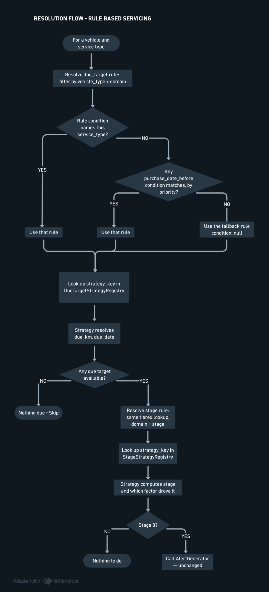

# Rule-Based Scheduling


## Purpose

Different vehicle types — and different age cohorts within the same vehicle type — need different due-service logic, without a code change every time a new type or cohort is introduced. This workflow externalizes that logic into data (service_rules), resolved per vehicle at check time, and dispatched to a small set of interchangeable strategy classes.


## Source
- `app/services/service_rule_resolver.rb`
- `app/services/stage_strategies/*.rb`
- `app/services/stage_strategy_registry.rb`
- `app/services/due_target_strategies/*.rb`
- `app/services/due_target_strategy_registry.rb`
- `app/models/vehicle_type.rb`
- `app/models/service_rule.rb`
- `app/models/general_service_milestone.rb`


## Vehicle Types

`vehicle_types` is a lookup table answering what a vehicle commercially is (for example, `RB` — Rental Bike, `MBS` — Managed Bike Subscription). Every vehicle belongs to exactly one type via `vehicles.vehicle_type_id`. Vehicle type is a property of the individual vehicle, not of its bike model — two vehicles of the same model can belong to different types and follow entirely different scheduling logic.

No behavior lives on `vehicle_types` itself. It exists only to be filtered on
when resolving rules.


## Two Kinds of Question, Two Domains

Due-service logic answers two genuinely different questions, and this workflow keeps them structurally separate rather than combining them into one algorithm:

| Domain | Question it answers | Inputs | Output |
| ------ | ------------------- | ------ | ------ |
| `due_target` | What are the due odometer reading and due date, right now, for this vehicle and service type? | vehicle, service type, schedule/milestones | `due_km`, `due_date` |
| `stage` | Given those due targets and the current odometer reading, how urgent is this — and does the date even matter? | `due_km`, `current_km`, `due_date`, `interval_km` | a stage (0–3) and which factor drove it |

A `due_target` strategy's output always feeds directly into a stage strategy's input. Neither strategy type is aware the other exists — the checkers (`DueServiceCheckerV2`, `GeneralServiceChecker`) are what wire the
two together, in that order, for every vehicle and service type.

This split is why a vehicle type like MBS can ignore due dates entirely (its `stage` strategy never looks at `due_date`) while still using the exact same `due_target` logic as everything else — and why general checkups can use an entirely different way of computing due targets (a milestone list instead of a repeating interval) while reusing the same urgency judgment as every other service type.

## `service_rules`

Each row maps a condition to a strategy, scoped to one vehicle type and one domain.

| Column | Meaning |
| ------ | ------- |
| `vehicle_type_id` | Which vehicle type this rule applies to.
| `strategy_domain` | `stage` or `due_target` — which question this rule answers. |
| `condition` | JSON describing when this rule applies. `null` means it is the fallback for this vehicle type and domain. |
| `priority` | Used to disambiguate between multiple matching date-based conditions — higher priority is checked first. |
| `strategy_key` | Looked up in the matching domain's registry to find the handler class. |
| `rule_config` | Tunables the strategy needs (for example, an interval override). |
| active | Inactive rules are never resolved. |


### Resolution Order

Resolution checks conditions in two independent tiers, then falls back:

```
1. Any rule whose condition names a specific service_type — checked first, regardless of priority, since this is a different kind of specificity than age-based cohorts and should not compete with them on the same scale
2. Any rule with a purchase_date_before condition matching the vehicle, checked in order of priority (a tighter cutoff should be given a higher priority than a looser one, so the more specific cohort wins when a vehicle satisfies both)
3. The fallback rule for this vehicle type and domain (condition: null)
```

If no rule matches at any tier, including the fallback, resolution raises an error rather than returning nothing — this indicates a configuration gap (a vehicle type was added without seeding its rules, or the only fallback was deactivated), which should surface immediately rather than silently stop alerting for a subset of the fleet.

### Adding a New Cohort or Vehicle Type

Adding a new age-based cohort, or a new vehicle type, requires no code change — only new `service_rules` rows (and, for a new vehicle type, matching `service_schedules` rows). Adding genuinely new behavior — a scheduling
approach that doesn't fit any existing strategy — requires one new strategy class and a registry entry, not a schema change.


## Strategy Registries

Each domain has its own registry, deliberately kept separate so a `strategy_key` can never be resolved against the wrong domain's handlers.

| Domain | `strategy_key` | Behavior |
| ------ | -------------- | -------- |
| `stage`	| `km_or_time` | Combines km-urgency and date-urgency; the higher stage wins. Default for RB. |
| `stage`	| `km_or_time_strict` | Same combination, tighter thresholds and/or a shorter interval, for an older cohort. |
| `stage`	| `km_only` | Considers only km-urgency; date is never evaluated. Default for MBS. |
| `stage`	| `km_only_conservative` | Same as `km_only`, with a shorter interval for an older cohort. |
| `due_target` | `model_schedule` | Reads the vehicle's last completed service for this service type, or falls back to its first odometer log and purchase date. |
| `due_target` | `general_milestone` | Reads an ordered milestone list, picks the next uncompleted milestone. |


## General Checkups

General checkups apply model-independently and follow a fixed, non-repeating schedule (for example, 3, 6, 12, 18 months from purchase) rather than one repeating interval — this is why they need their own `due_target` strategy instead of `service_schedules`.

`general_service_milestones` holds this list as real rows, not a JSON blob, because the data has structure (an order) and a lifecycle (individual milestones may be added, edited, or reordered) that a flat config value
does not need to support. Each row belongs to one `service_rules` row via `service_rule_id`.

```
Count completed `service_records` for this vehicle and service type
  → Look up the milestone at that position in the ordered list
  → If every milestone is already completed, nothing is due
  → Otherwise, due_km and due_date are computed from that milestone's
    interval, added to the vehicle's earliest odometer log and purchase
    date — not from the vehicle's most recent service
```

The resulting due targets are passed into the same staged alerting as every other service type — a general checkup due in 25 days behaves identically to a model-based service due in 25 days.





